# Cloud Operations, Monitoring & Recovery Lab

## Project Overview

This project demonstrates practical cloud operations skills using Amazon Web Services (AWS). It covers infrastructure deployment, access management, monitoring, backup and restoration, and incident recovery on an Ubuntu EC2 instance.

The lab was designed to practise operational troubleshooting and verify recovery procedures through repeatable tests.

## Objectives

- Deploy an Ubuntu EC2 instance in a custom VPC.
- Configure network routing and restrict SSH access.
- Assign an IAM role to support Systems Manager and CloudWatch monitoring.
- Monitor CPU utilization, memory usage, and disk usage.
- Configure a CloudWatch CPU alarm.
- Create and verify a compressed file backup.
- Restore backed-up data and verify file integrity.
- Simulate an Nginx service outage, restore the service, and verify availability.

## AWS Services and Technologies

- Amazon EC2
- Amazon VPC
- AWS IAM
- AWS Systems Manager
- Amazon CloudWatch
- CloudWatch Agent
- Ubuntu Server 24.04 LTS
- Nginx
- Linux shell commands
- Git

## Implementation Summary

### 1. Infrastructure and Access

Created a custom VPC with a public subnet, internet gateway, route table, and an Ubuntu EC2 instance. SSH access was restricted to the configured client IP address.

An EC2 IAM role was configured for Systems Manager connectivity and CloudWatch Agent permissions.

### 2. Monitoring

Configured the CloudWatch Agent to publish custom metrics in the `CloudOps-Lab` namespace:

- `mem_used_percent`
- `disk_used_percent`

Both metrics were verified in CloudWatch. A CPU utilization alarm named `CloudOps-Lab-High-CPU` was configured with a threshold above 70% over a five-minute period. The alarm was observed in the `OK` state during validation.

### 3. Backup and Restoration

Created a compressed archive of a sample file using `tar`. Inspected the archive, restored it into a separate directory, and compared the original and restored files using `diff`.

The comparison returned no differences, confirming that the restored file matched the original.

### 4. Incident Simulation and Recovery

Installed and started Nginx, then verified the local HTTP response.

A controlled outage was simulated by stopping the Nginx service. The service state changed to `inactive`, and the local HTTP request failed as expected.

Nginx was restarted successfully. The service returned to `active`, and the HTTP test returned `200 OK`.

## Evidence

The following screenshots provide selected evidence from the lab. Supporting technical documentation is available in the `docs/` directory.

### 1. Infrastructure and Access

**VPC and subnet configuration**

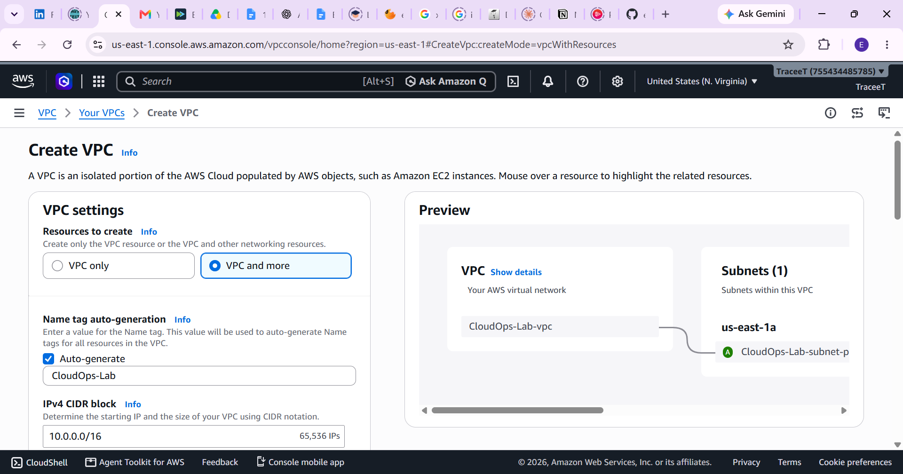

**EC2 IAM role permissions**

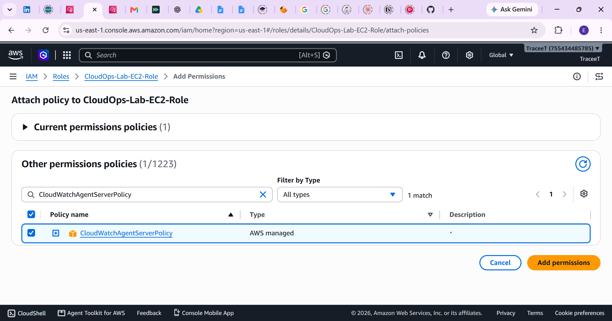

**IAM role attached to the EC2 instance**

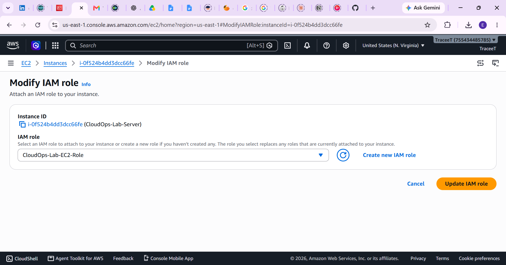

### 2. CloudWatch Monitoring and Alerting

**CloudWatch Agent configuration**

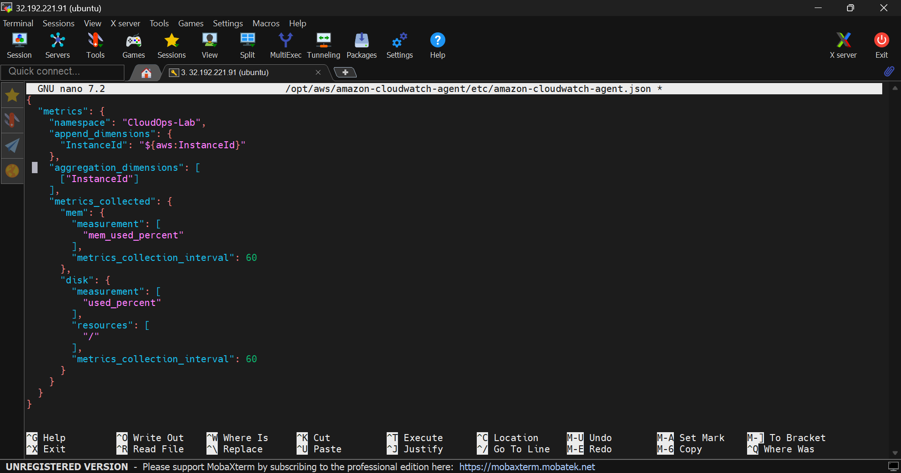

**CloudWatch metrics dashboard**

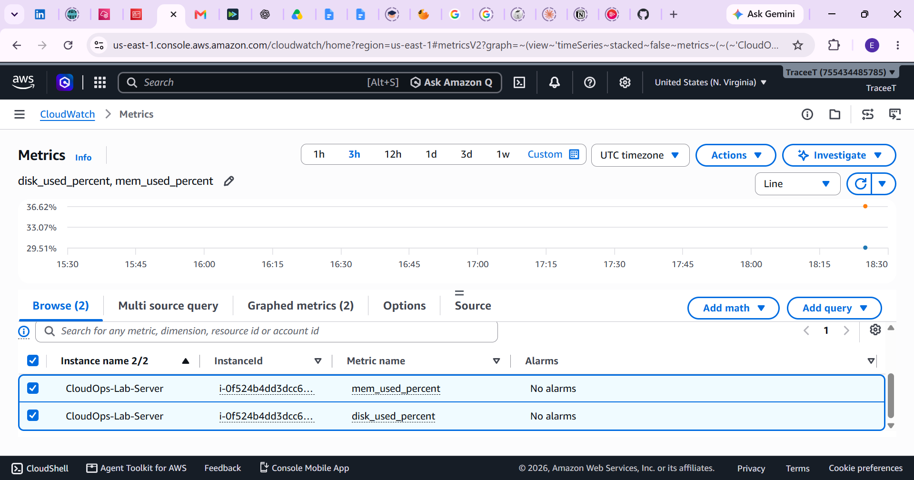

**CPU utilisation monitoring**

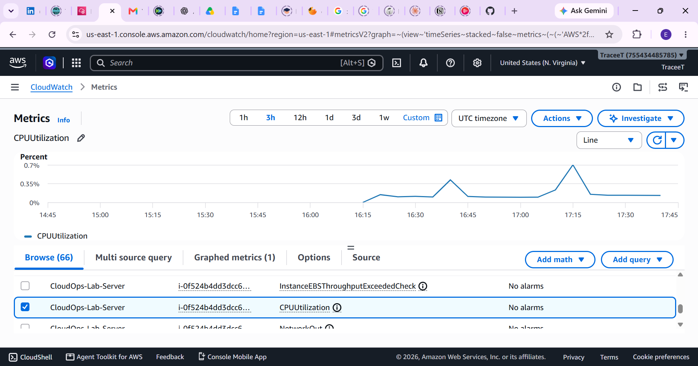

**CPU alarm validation**

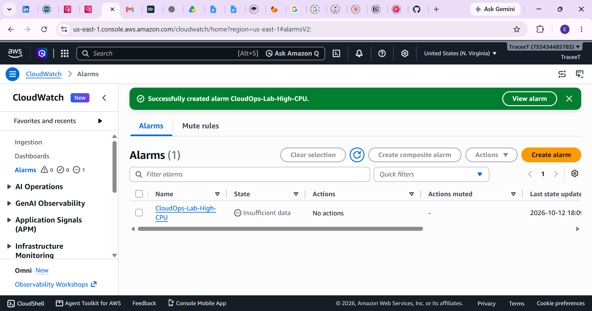

### 3. Incident Simulation and Recovery

**Nginx outage simulation**

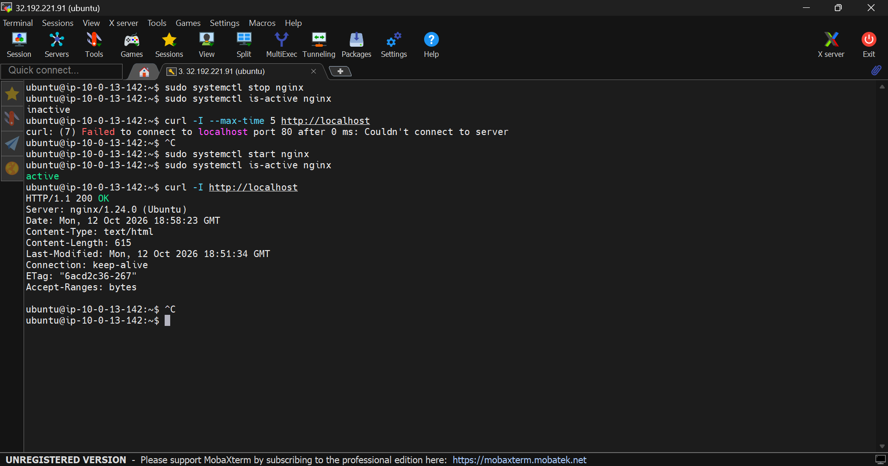

**Nginx service status check**

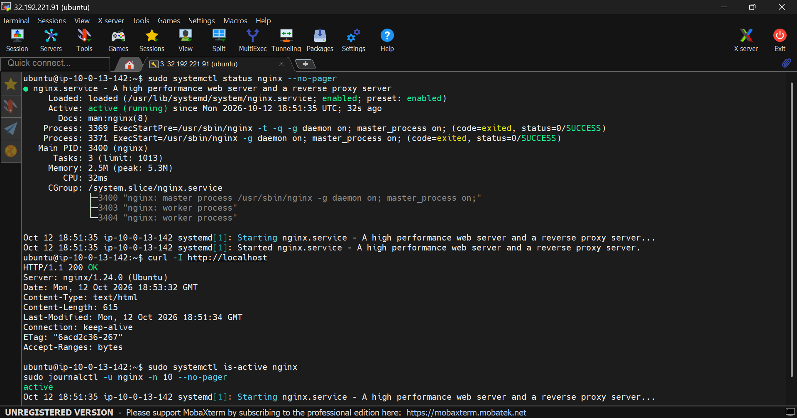

**Recovery test output**

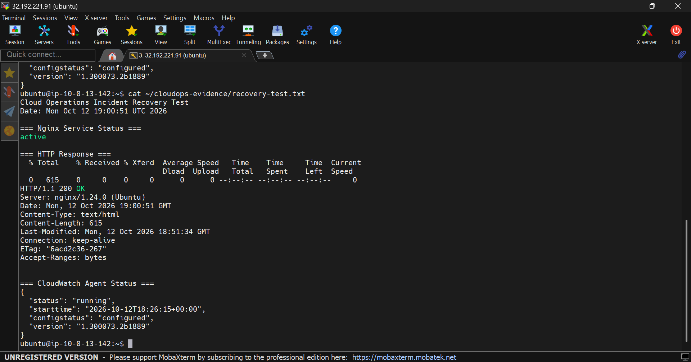

### 4. Repository Publication

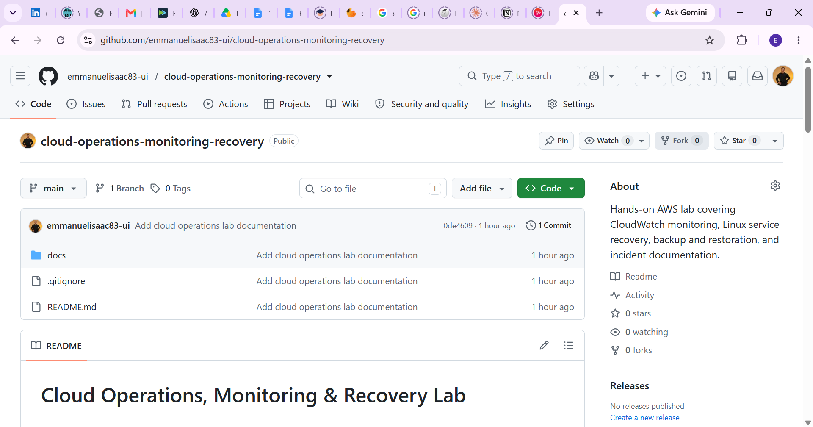

### Supporting Technical Documentation

- [Architecture and infrastructure](docs/architecture.md)
- [Monitoring configuration](docs/monitoring.md)
- [Incident report](docs/incident-report.md)
- [Recovery runbook](docs/recovery-runbook.md)

**Evidence note:** This is a practical learning lab. Backup validation used a sample file. Incident recovery was tested by stopping and restarting Nginx and checking its local HTTP response.
## Security Considerations

- SSH access was restricted to a specific client IP address.
- IAM roles were used instead of embedding AWS credentials in scripts.
- No private keys, access keys, passwords, or other secrets should be committed to this repository.
- Public HTTP access was not required for the local Nginx recovery test.

## Cost Considerations

AWS resources and CloudWatch custom metrics may incur charges depending on account eligibility and usage. Resources should be reviewed and cleaned up when the lab is complete.

## Learning Outcomes

This project provided hands-on practice with cloud networking, IAM, Systems Manager, infrastructure monitoring, Linux service management, backup validation, and incident recovery.

## Disclaimer

This is a learning lab. The tests were performed on a personal AWS environment and do not represent a production deployment or a formal disaster recovery service-level agreement.
